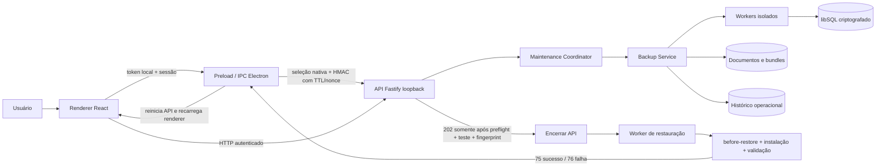

# Fluxo e fronteiras de confiança

## Fronteiras

- O renderer nunca recebe chave de banco ou chave de recuperação persistente.
- A seleção nativa emite autorização HMAC ligada ao caminho, nonce e prazo.
- Depois da correção A19-02, o nonce testado também é ligado ao fingerprint SHA-256 do bundle validado; o worker revalida o fingerprint.
- A API aceita operações somente por loopback/token e recusa restauração real fora do desktop gerenciado.
- A troca física preserva `before-restore`; rollback remove instalação parcial e recoloca banco/documentos anteriores.
- Pasta sincronizada é apenas destino local observável. O produto não confirma upload, imutabilidade, versionamento ou restauração do provedor.
